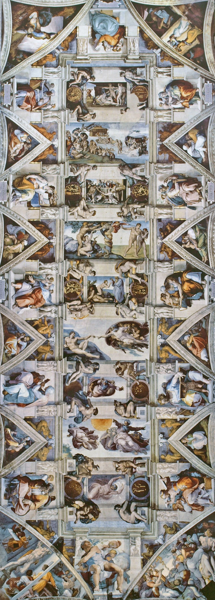

# 米开朗基罗的弓

**我弯曲的像一张叙利亚的弓**

2026/10/31

> 这工作把我肺都气肿了，
> 像伦巴第的猫一样弓着背,
> 或者不知道什么鬼地方,
> 我的肚子挺的比下巴还高，
> 我的胡子指上了天，
> 我的记忆都被装进了棺材，
> 我的乳房像女妖一样扭曲。

> 我的画笔悬在我头顶上，
> 颜料不断滴落,
> 在我脸上像调色版一样,
> 我的鸡巴都缩到腹股沟里去了,
> 我可怜的屁股努力地充当着配重，
> 我做的每一个动作都是盲目的。
> 我身前的皮肤紧绷着,
> 都皱皱巴巴的折到身后去了,
> **我弯曲的像一张叙利亚的弓**。

> 因为我被困在这里，
> 批判不断生长脑海浮现一些废话例如: 
> 任何人通过弯曲的吹管射击都会很糟糕。

> 我的画死了。
> 为我辩护吧，
> 乔瓦尼，保护我的荣誉。
> 我不在正确的地方,
> 我不是一个画家。

这是米开朗基罗在画西斯廷教廷天顶时写的十四行诗,我觉的用来形容我现在面对AI的感受再适合不过.在AI出现之前我们伏案工作,同事们都会有点头前倾,颈椎曲度变直的毛病,现在完全反过来了,那些需要躬身去做的事交给AI,终于从繁琐的细节苦痛中解脱,我们终于可以抬起头看向远方做一些更重要的事啦!但事情发展的并不像预期的那样顺利,我感觉我现在就像诗中所形容的那样,被AI拉成一张叙利亚的反曲弓,以一种极为不自然的姿势承受另一种痛苦.从此我们只能仰望星空不再脚踏实地,我们必须承受悬在半空中的失重感.不再建造坚实的地基,让渡控制权给AI,而这是飞向未来必须的一跃.  

我之前一直试图与AI共生,我做了[BlenderSlot](https://github.com/davidkingzyb/BlenderSlot)试图将AI整合进工作流中,[SCAST](https://github.com/davidkingzyb/SCAST)用于理解AI的产出,以及[Pi-O1](/blogmd/53.html)这个集中了更多智能体及工具的框架,试图去隔绝AI的冲击控制AI,知晓其原理并与其共生.社区似乎也朝着这个方向发展,Prompt,Alignment,ControlNet,Harness各种概念工具和范式曾出不穷.同时AI模型也在内化一些能力像是思维链,RSI变得更加智能,Jev这类模型又可以取代很多专有的算法,模型不再需要精细的提示词,不再需要缰绳保证它长时间的在轨运行,甚至不需要外部专门的判断,一切都可以在内部的黑箱中模拟.我们在见证AI降神,享受只需祈祷,一句话便可以生成想要的东西的同时,失去控制,失去理解力,最终失去创造力.这件事正在发生,我让O1每天收集github上每天最火的项目,九成与AI相关如果看新项目或者有AI参与的应该有99%,而且其中很大一部分是AI对一些已有的软件重写,没什么不好,只是没有像之前AI刚出现时那样让人惊艳,这算不算是一种倒退呢?  

在其他领域这件事同时在发生,AI用几小时证明出人类几百年没证明的定理,写出千万行的LEAN验证代码.有时候我觉的应该放弃理解AI,停止review代码,放弃控制权,像对待另一个人一样,让他建立自己的巴别塔,然后和自己心中建立的比较,不断抽卡推倒重建直到妥协.但有时候又控制狂发作,像米开朗基罗一样,我要按我的意志描绘创世纪,为此我不单要躬身去画草图,我要反向将自己弯成一张叙利亚的弓拿着笔亲手教AI画.我并没有变得轻松反而更累了,我发现用自然语言跟AI讲逻辑的过程和直接用代码实现没有区别,甚至更难.也许这是粒度选择或者现实反馈没有建立的问题,但循环已经转起来了,想要加入控制就得让它停下再重启.而停下的那一瞬我失语了,我发现这是语言本身的问题,这个问题在行与行之间,那些文字中的空隙,无法描述的地方,我不知道如何给AI说,尝试大盘鸡文学了一下失败了.于是我想亲自做给AI看,然后在做的过程中发现,哦原来我也不会做,于是我只能尝试,不断推倒重建直到完成.  

我又回到了AI出现之前的日子,有什么不同吗?我想有的,AI出现之前我可没计划揽下西斯廷天顶的活.所以再试一把,让我们把上下文清空,抛掉之前的经验,像第一次踏进这个世界的勇者一样,再来一把!